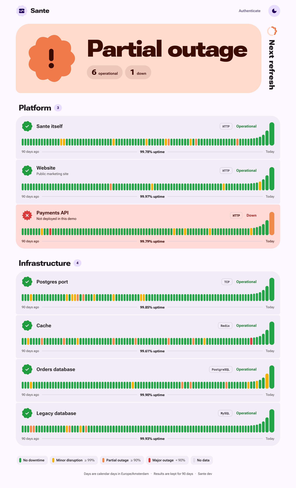

# Sante

A self-hosted uptime monitor for HTTP endpoints, TCP ports, Redis, MySQL and
PostgreSQL. You configure it with one YAML file. It keeps 90 days of results
in SQLite, shows them on a status page, and sends down alerts to Slack or
Mattermost.



## Quick start

### Docker Compose demo

```sh
docker compose up --build
```

Open <http://localhost:8080> and use the token `sante`. The demo runs Redis,
PostgreSQL and MySQL next to Sante and fills in 90 days of fake history. One
monitor, Payments API, is always down so there's an outage to look at.

If port 8080 is taken, run `SANTE_PORT=9090 docker compose up`.

### Docker

```sh
docker build -t sante .
docker run -d --name sante -p 8080:8080 \
  -v $PWD/config.yaml:/etc/sante/config.yaml:ro \
  -v sante-data:/data \
  -e TZ=Europe/Amsterdam -e DB_PASSWORD=... \
  sante
```

The database goes in the `/data` volume. If you don't mount a config, the
image uses `config.example.yaml`, which won't start until `SANTE_TOKEN` is set.

### From source

Requires Go 1.27.

```sh
cp config.example.yaml config.yaml
go run . -config config.yaml
```

## Commands

```
sante [serve] [-seed]   run the monitor and web UI (default)
sante seed [-reset]     fill the database with 90 days of fake history
sante validate          check the config and list the monitors
sante test-webhooks     send a test alert to every webhook
sante healthcheck       exit 0 if the local instance is healthy
sante version           print the version
```

Every command takes `-config path`. The default is `$SANTE_CONFIG`, then
`config.yaml`.

## Configuration

Every setting is described in [docs/configuration.md](docs/configuration.md).
[`config.example.yaml`](config.example.yaml) is a commented example.

## Demo data

To get a full status page without waiting 90 days:

```sh
sante serve -seed    # seed on startup if the database is empty
sante seed           # seed and exit; refuses if there's already data
sante seed -reset    # delete the configured monitors' history, then seed
```

You get the same history for a monitor every time you seed it: normal
latencies, a few outages, and the odd failed check. Real checks take over
from the moment Sante starts.

## Development

Requires Go 1.27. The tests need no database servers or network access, so
they run anywhere:

```sh
go test ./...
go vet ./...
gofmt -l .     # lists files that need formatting
```

### With Docker Compose

```sh
docker compose watch
```

This runs the same demo as the quick start: every monitor has a live target
and the token is `sante`. Compose rebuilds Sante whenever a source file
changes and restarts it when `config.example.yaml` changes. Edits to test
files are ignored.

### From source

```sh
cp config.example.yaml config.yaml
SANTE_TOKEN=dev SANTE_LOG_LEVEL=debug go run . -seed
```

Open <http://localhost:8080> and use the token `dev`. Debug logging prints
every check. The database is `data/sante.db`. Delete `data/` to start over,
or run `SANTE_TOKEN=dev go run . seed -reset` to regenerate the demo history.
`config.yaml` and `data/` are both gitignored.

The templates and static files in `internal/web` are embedded in the binary,
so restart after editing them. You don't need a hard refresh: asset URLs
change whenever a static file does.

The Infrastructure monitors in the example config point at the Compose
service names (`postgres`, `redis`, `mysql`), so outside Compose they show as
down. Set `POSTGRES_HOST`, `REDIS_HOST` and `MYSQL_HOST`, plus the matching
`*_PASSWORD` variables, to point them at servers you have, or remove them from
your `config.yaml`.

To stamp a version into a build:

```sh
go build -ldflags "-X main.version=1.2.3" .
```
